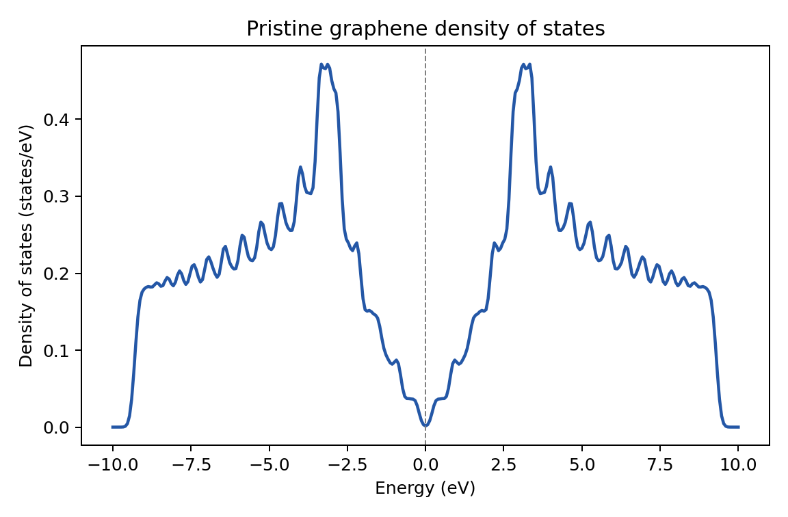

# 02: Pristine graphene density of states

This example computes the graphene density of states by diagonalizing the
two-band Bloch Hamiltonian on a `30 x 30` k-point grid and applying Gaussian
broadening. It is deterministic and intended as a quick installation check.

## Expected result



This is the figure `plot.py` draws from the reference data. After `./run.sh`, `python3 plot.py`
writes `graphene_dos.png` in this folder from your own run; the two figures should look the same.

## Run

```sh
./run.sh
python3 plot.py
```

The calculation writes `generate.diag.DOS` and `job.out`; the plotting step
writes `graphene_dos.png`. If the calculation has not been run, `plot.py` uses
`reference/dos.dat`.

Important controls are `KGrid`, `NumberofEnergyPoints`, `Epsilon`,
`DOS.Emin`, and `DOS.Emax`. Denser k-point or energy grids improve the curve
but take longer.
