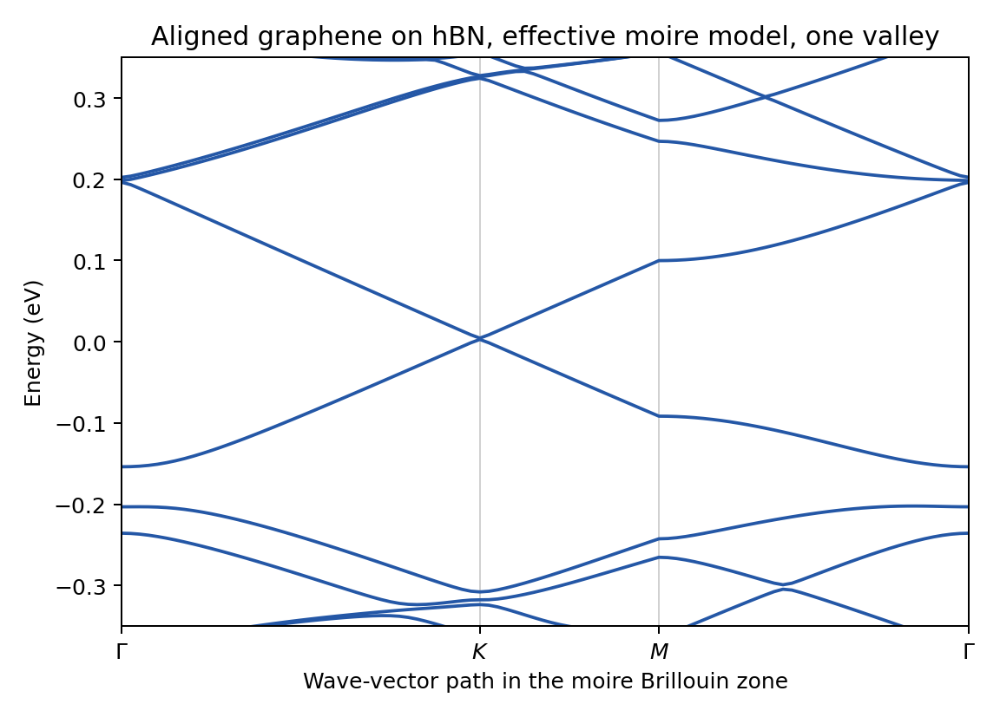

# 05: Aligned graphene on hBN, moire bands

Graphene on hexagonal boron nitride at zero twist, described by the effective
moire model of Jung, Raoux, Qiao and MacDonald, Phys. Rev. B 89, 205414
(2014): the hBN layer is not simulated; its effect on the graphene electrons
is a potential with the period of the moire pattern, added to the
nearest-neighbor tight-binding model of graphene. The example computes the
bands of one valley along `Gamma - K - M - Gamma` of the moire Brillouin zone.

## Expected result



This is the figure `plot.py` draws from the reference data. After `./run.sh`, `python3 plot.py`
writes `graphene_hbn_bands.png` in this folder from your own run; the two figures should look the same.

## The cell

`Structure.CellSize 55` builds 55 x 55 graphene cells (6050 atoms), one moire
cell of 13.5 nm for a lattice mismatch of -1/55 (`Moire.LatticePercent`). The
mismatch enters the moire potential only; the cell must hold a whole number of
moire periods, which is why the two numbers go together.

## The model

- Graphene: nearest-neighbor hopping, 2.9887 eV (the default `TB.Hopping` for
  a lattice constant of 2.46 A).
- Moire terms (`Moire.Jeil`, `Moire.H0AndHZ`, `Moire.OffDiag`): a scalar
  potential, a sublattice-staggered potential and a modulation of the hopping,
  each a first-harmonic function with the amplitudes and phases of the paper
  (`Moire.PotC0`, `PotCz`, `PotCab` in eV; `PotPhi0`, `PotPhiz`, `PotPhiab` in
  radians).
- `Moire.OffDiagMidpoint .true.` evaluates the hopping modulation at the
  middle of each bond, which makes the Hamiltonian Hermitian. Without it the
  term is evaluated at the first atom of the bond, the two directions of a
  bond differ slightly (the solver prints by how much), and the bands differ
  by about 0.1 meV.

## The plane-wave reduction

A direct diagonalization of 6050 atoms per k-point is slow. With `TAPW.Use`
the Hamiltonian is projected on plane waves around one graphene valley
(`Diag.N_G 8`: 55 moire reciprocal vectors, two sublattices, 110 states), and
the 110 x 110 matrix is diagonalized. This gives the bands of ONE valley; the
other valley (`Diag.UseKprimeValley .true.`) is its mirror image in k.

The reduction was compared with the direct diagonalization of the same
Hamiltonian in both directions (October 2026): at seven k-points, the levels
of the two valleys together are the exact levels within 0.3 eV of neutrality,
78 of 78, with differences below 0.001 meV.

Run the reduction with one OpenMP thread (`run.sh` sets `OMP_NUM_THREADS=1`).

## What to look for

- The graphene Dirac point folds to a corner of the moire zone. For this
  valley it is the corner (1/3, 2/3) in units of the reciprocal vectors of the
  cell, labelled `K` in the figure; the other valley has it at (2/3, 1/3).
- A gap of 1.7 meV at the Dirac point.
- On the hole side, a gap of 48 meV along this path between the first and the
  second band (at -0.15 and -0.20 eV); on the electron side the corresponding
  gap is only 2 meV (at 0.196 eV). This asymmetry is the known signature of
  the model.

The numbers above are those of this model and these parameters. A relaxed
atomic structure changes them (the gap at the Dirac point in particular).

## Run

```sh
./run.sh
python3 plot.py
```

The calculation takes about 20 seconds. It writes `generate.bands` and
`job.out`; the plotting step writes `graphene_hbn_bands.png`. If no calculated
file exists, the plotter uses `reference/bands.dat`.
