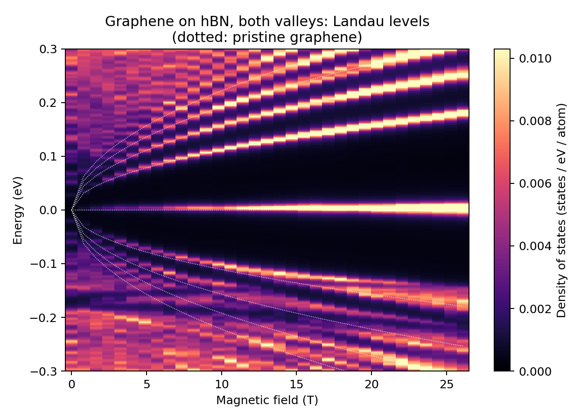

# 06: Aligned graphene on hBN, Landau levels against magnetic field

The density of states of the system of example 05 in a perpendicular magnetic
field, for 33 fields from 0 to 26 T: the Landau-level fan of the Dirac point,
the second fan that starts from the secondary Dirac point on the hole side,
and the beginning of the Hofstadter pattern where the two meet.

The map contains **both valleys**: it is computed on the full tight-binding
Hamiltonian in real space, without the one-valley plane-wave reduction of
example 05. In a field the two valleys of this system have different levels
(hBN breaks inversion symmetry), and the map is their sum, per atom and for one
spin.

## Expected result



This is the figure `plot.py` draws from the reference data. After `./run.sh`, `python3 plot.py`
writes `landau_levels.png` in this folder from your own run; the two figures should look the same.

## Method

- **Cell.** 8 x 8 moire cells (`Structure.SuperCell 8`), 387 200 atoms. The
  model is the one of example 05.
- **Magnetic field.** A Peierls phase on every hopping, in a gauge that is
  periodic in the supercell. This is possible only when a whole number m of
  flux quanta passes through the supercell, so the fields are
  B = m x 0.4076 T (`MagField.InitialInteger`, `FinalInteger`, `IntegerStep`;
  m = 0, 2, ..., 64). m = 64 is one flux quantum per moire cell, 26.09 T.
  These three keys make the run a sweep: one calculation per field, each
  written to its own directory `m<m>_B<field>/`. For a single field use
  `MagField.Integer m` instead.
- **Density of states.** The recursion (Lanczos) method with one random
  vector: 3000 steps, a broadening of 4 meV (`Kubo.Epsilon`, in eV), 601
  energies between -0.3 and 0.3 eV. Nothing is diagonalized, so the cost grows
  linearly with the number of atoms.

`Moire.OffDiagMidpoint .true.` is required here: the recursion method needs a
Hermitian Hamiltonian.

## What limits the resolution

- The broadening must be supported by the number of recursion steps: steps
  needed ~ (width of the whole spectrum, 18 eV) / broadening. 3000 steps and
  4 meV are a compromise for a short run; halving the broadening needs twice
  the steps.
- At a field of m flux quanta every level of the supercell is degenerate, and
  a chain of N steps is meaningful only while N is well below
  (number of atoms) x gcd(m, 64) / 64. With even m this bound is at least
  12 100, four times the chain used here. Odd m would halve it.
- A larger supercell gives a finer field step (B = m x 26.09 T / SuperCell^2)
  and less noise.

## What to look for

- Levels that follow E_N = sgn(N) v_F sqrt(2 e hbar B |N|) of pristine
  graphene at low field (dotted lines in the figure; v_F is that of the
  nearest-neighbor model, hbar v_F = 6.37 eV A), with a level that stays at
  the Dirac point.
- On the hole side the levels are not those of pristine graphene: they bend,
  split and cross between -0.15 and -0.25 eV, the energy of the secondary
  Dirac point of the moire bands (example 05). The electron side stays close
  to the pristine fan, in line with the weak moire features there.
- Below about 4 T the levels are closer than the broadening and the map shows
  the discrete levels of the supercell instead.

## Run

```sh
OMP_NUM_THREADS=4 ./run.sh
python3 plot.py
```

With four threads the 33 fields take about four minutes and 250 MB of memory.
The plotting step reads the directories of the run and writes
`landau_levels.png`; without a run it uses `reference/dos_map.dat`
(energy in eV in the first column, then the density of states at every field).
`python3 plot.py --table FILE` writes the same table from a run.
