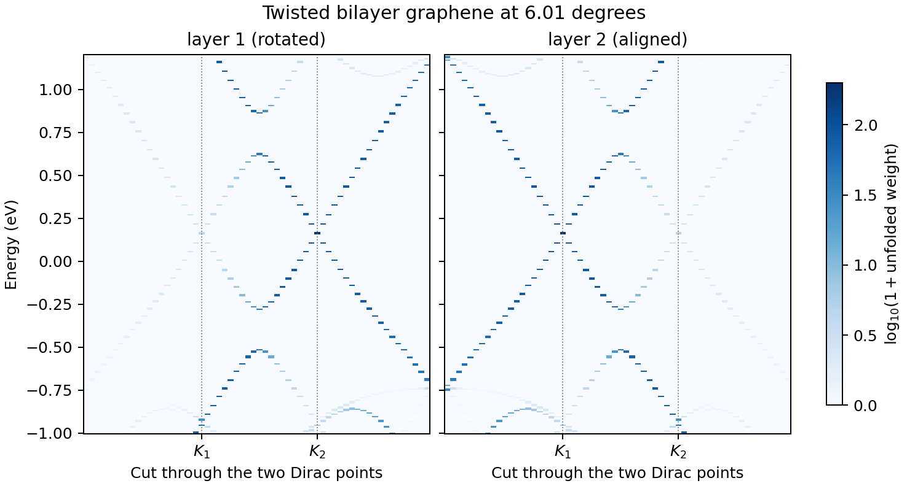

# 10: Twisted bilayer graphene, unfolded spectral function

The spectral function of twisted bilayer graphene at 6.01 degrees: the
commensurate cell `(m, n) = (6, 5)` with 364 atoms, built by the solver. The
states of the moire cell are unfolded on the graphene lattice, one layer at a
time, along a cut through the Dirac points of the two layers.

## Expected result



This is the figure `plot.py` draws from the reference data. After `./run.sh`, `python3 plot.py`
writes `spectral_function.png` in this folder from your own run; the two figures should look the same.

## What to look for

- Each layer has its strong Dirac cone at its own point: layer 2 at `K1`, layer 1 at `K2`.
- The weak copies of the same cone at the other point come from the coupling between the layers.
- Between `K1` and `K2` the two cones hybridize and open the gaps of the moire bands.

## The reference lattice

`Spectral.Path` is given in fractional coordinates of a graphene lattice with
`a1` along x, whatever the cell. `Calculate.Spectral` projects on plane waves
of that lattice, so the result is the spectral function of a layer only if the
layer has that orientation:

| Layer | Orientation | Keys that make it the reference |
| --- | --- | --- |
| 2 | along the reference lattice | none |
| 1 | rotated by the twist angle | `Spectral.AlignReferenceSystem .true.`, `Spectral.AlignmentAngle` = the twist angle |

The cut of this example passes through both Dirac points, so it shows both
layers in one run. For other twist angles the coordinates of `K2` in
`Spectral.Path` change: `K2` is `K1 = (2/3, 1/3)` rotated by the twist angle.

## Energy units

- `Spectral.Emin` and `Spectral.Emax` are in eV since 2026-10-30. They were in units of `TB.Hopping`
  before, so older inputs must multiply them by `TB.Hopping`; a warning in `job.out` says so.
- The energy column of the output files is still in units of `TB.Hopping` (3.5 eV here). `plot.py`
  multiplies it back to eV.
- `Spectral.energyGridResolution` is in eV: a state adds its weight to every energy point closer than
  this. If the points are more than twice that apart, states fall between them and are missing from
  the output; the run prints a warning in that case.

## Output

`generate.spectral<layer><sublattice>`, for example `generate.spectral1A`, with
columns distance along the path [1/A], energy [`TB.Hopping`] and weight. The
sublattices of a layer are added here without their relative phase. The weight
is not normalized: at a k-point where one layer's state unfolds completely, A
and B together carry half the number of atoms of the layer.

## The model and the check

The model of example 08 (F2G2 intralayer, two-center interlayer with factor
1.008 on a rigid lattice). This is direct diagonalization at every k-point: the
plane-wave reduction of example 08 is not used.

Checked in October 2026 on the cell `(m, n) = (3, 2)` with the layers decoupled
(`Interlayer.CouplingFactor 0`), against the same model on the primitive cell,
on the same k-points and energy points: in both directions, 94 of 94 levels
within 10.5 eV. Each layer agrees only with the reference lattice of its own
orientation, and not with the other one. The result of this example is the same
with GNU and Intel Fortran at the precision of the output.

## Other twist angles

Near the magic angle, `(m, n) = (31, 30)` has 11 164 atoms. Each k-point then
takes a dense diagonalization of that size, minutes on a cluster node, so it is
not a calculation for this example. With relaxed structures use factor 0.895.

## Run

```sh
./run.sh
python3 plot.py
```

The calculation takes about 10 seconds on four cores. It writes
`generate.spectral*` and `job.out`; the plotting step writes
`spectral_function.png`. If no calculated file exists, the plotter uses
`reference/spectral.dat`.
