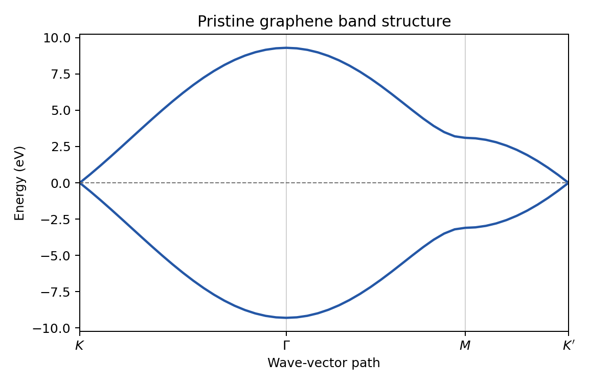
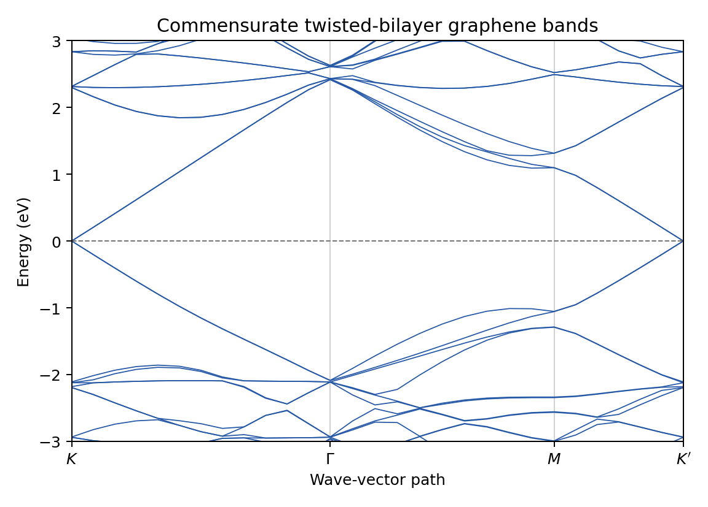

# GRABNES examples

These examples are ordered from a fast installation check to more complete
moire calculations.

| Example | Purpose | Status |
| --- | --- | --- |
| [`01_graphene_bands`](01_graphene_bands/) | Pristine graphene band structure | Ready |
| [`02_graphene_dos`](02_graphene_dos/) | Pristine graphene density of states | Ready |
| [`03_twisted_bilayer_bands`](03_twisted_bilayer_bands/) | 76-atom commensurate twisted-bilayer bands | Ready |
| [`04_twisted_bilayer_dos`](04_twisted_bilayer_dos/) | 76-atom commensurate twisted-bilayer DOS | Ready |
| [`05_graphene_hbn_bands`](05_graphene_hbn_bands/) | Aligned graphene on hBN (effective moire model): bands of one valley | Ready, 20 s |
| [`06_graphene_hbn_landau_levels`](06_graphene_hbn_landau_levels/) | Same system in a magnetic field: density of states against field, 0 to 26 T | Ready, 4 min |
| [`07_graphene_hbn_twist_series`](07_graphene_hbn_twist_series/) | Graphene on hBN at four twist angles: density of states | Ready, 5 min |
| [`08_magic_angle_twisted_bilayer`](08_magic_angle_twisted_bilayer/) | Twisted bilayer graphene at 1.08 degrees: flat bands | Ready, 2 min |
| [`09_alternating_twist_trilayer`](09_alternating_twist_trilayer/) | Alternating-twist trilayer at 1.54 degrees, structure read from files | Ready, 3 min |

## Quick start

First compile GRABNES so that the executable is available at
`lanczosKuboCode/bin/grabnes` (see the repository README). Then run:

```sh
cd examples/01_graphene_bands
./run.sh
python3 plot.py
```

Set `GRABNES_BIN` if the executable is located elsewhere:

```sh
GRABNES_BIN=/path/to/grabnes ./run.sh
```

Each example contains its input, a short explanation, a plotting script, and
reference data from a known-good calculation. Examples 01 and 02 run in a few
seconds; examples 03 and 04 use a small, 76-atom commensurate twisted bilayer
so they remain practical laptop checks rather than production calculations.
Examples 05 to 09 are moire systems at realistic sizes.

Examples 01 to 04 use exact diagonalization. Examples 05, 08 and 09 project the
Hamiltonian on plane waves around one graphene valley, which makes cells of
several thousand atoms a matter of minutes; each of them states how the
reduction was checked against exact diagonalization. Examples 06 and 07 use
the recursion method on cells of 0.4 and 3.5 million atoms; example 07 needs
1.5 GB of memory. The times in the table are for a build with gfortran on
four cores.

All examples must be run with a single MPI process. To check every example against its reference data in one step,
without writing into this directory, use:

```sh
./tests/regression/run_examples.sh
```

## Expected figures

The figure each example produces, drawn from its reference data (`<example>/reference/*.png`).
Compare with the figure `plot.py` writes after your own run. `sh make_reference_figures.sh`
draws all of them again from the reference data.

### 01: Pristine graphene bands

[](01_graphene_bands/)

### 02: Pristine graphene density of states

[](02_graphene_dos/)

### 03: Twisted-bilayer graphene bands

[](03_twisted_bilayer_bands/)

### 04: Twisted-bilayer graphene density of states

[](04_twisted_bilayer_dos/)

### 05: Aligned graphene on hBN, moire bands

[](05_graphene_hbn_bands/)

### 06: Aligned graphene on hBN, Landau levels against magnetic field

[](06_graphene_hbn_landau_levels/)

### 07: Graphene on hBN, a series of twist angles

[](07_graphene_hbn_twist_series/)

### 08: Twisted bilayer graphene near the magic angle

[](08_magic_angle_twisted_bilayer/)

### 09: Alternating-twist trilayer graphene, structure read from files

[](09_alternating_twist_trilayer/)
